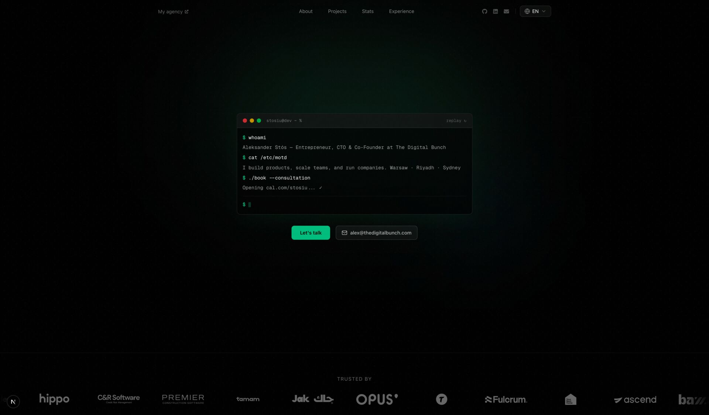

<div align="center">



# nextjs-developer-portfolio

A developer portfolio that doesn't look like every other developer portfolio.

[](https://github.com/Stosiu/nextjs-developer-portfolio/actions/workflows/ci.yml)
[](https://github.com/Stosiu/nextjs-developer-portfolio/releases/latest)
[](https://nextjs.org/)
[](https://typescriptlang.org/)
[](https://tailwindcss.com/)
[](LICENSE)

[Live demo](https://stosiu.dev) · [Deploy](#deploy) · [Personalizing](#personalizing) · [Environment variables](#environment-variables)

</div>

Dark theme only. There is no light mode, and that's a feature. Ships with i18n (English, Polish, Arabic with full RTL), a live stats dashboard pulling from GitHub, Claude Code and Spotify, and a few Easter eggs for people who like right-clicking. Fork it, swap the config files, deploy.

## Deploy

[](https://vercel.com/new/clone?repository-url=https%3A%2F%2Fgithub.com%2FStosiu%2Fnextjs-developer-portfolio&env=NEXT_PUBLIC_SITE_URL&envDescription=Your%20deployed%20site%20URL%20(optional%20-%20used%20for%20SEO)&envLink=https%3A%2F%2Fgithub.com%2FStosiu%2Fnextjs-developer-portfolio%23environment-variables&project-name=developer-portfolio&repository-name=developer-portfolio)
[](https://app.netlify.com/start/deploy?repository=https://github.com/Stosiu/nextjs-developer-portfolio)
[](https://render.com/deploy?repo=https://github.com/Stosiu/nextjs-developer-portfolio)

Vercel is the recommended host, because the template uses Vercel Cron to keep the stats cache warm. Anywhere else, point your own cron at `/api/cron/stats` ([details](docs/stats.md#warming-the-cache)).

## Features

- Terminal hero with a replayable typing animation
- Live stats from GitHub, Claude Code (via [ccusage](https://github.com/ryoppippi/ccusage)) and Spotify
- Open source section with live merged pull requests, stars and npm downloads
- Markdown blog with search, tags and pagination
- 3D travel globe with pins and sticky notes, logo marquee, project cards, experience timeline
- English, Polish and Arabic with full RTL
- Opt-in analytics behind a GDPR consent banner, with a generated privacy policy
- Every external integration disables itself when its env var is missing

Built with Next.js 16, React 19, TypeScript, Tailwind CSS v4, shadcn/ui, next-intl, Framer Motion, Vitest and oxlint. There are Easter eggs: try <kbd>⌘</kbd> <kbd>,</kbd>, right-click, and the console.

## Getting Started

```bash
pnpm install
cp .env.example .env   # every variable is optional
pnpm dev
```

## Personalizing

| File | What to change |
|---|---|
| `src/config/site.ts` | Name, email, social links, booking URL, agency, nav sections |
| `src/config/experience.ts` | Work history |
| `src/config/open-source.ts` | Repositories you contribute to, with an optional npm package |
| `src/config/logos.ts` | Client logos |
| `src/config/companies.ts`, `side-projects.ts` | Footer company details and side projects |
| `src/config/travel.ts` | Visited places and visits |
| `src/lib/data.ts` | Projects |
| `messages/{en,pl,ar}.json` | All user-facing text |
| `src/app/globals.css` | Accent color (`--color-brand-*`, `--accent-rgb`) |

## Environment Variables

All optional. A missing value disables its feature without errors.

| Variable | Purpose |
|---|---|
| `NEXT_PUBLIC_SITE_URL` | Canonical URL for SEO, sitemap and robots.txt; use the host that does not redirect |
| `NEXT_PUBLIC_GA_ID` | GA4, consent banner and privacy page |
| `NEXT_PUBLIC_SPEED_INSIGHTS`, `NEXT_PUBLIC_VERCEL_ANALYTICS` | `1` enables the Vercel integration |
| `GITHUB_TOKEN` | GitHub stats and open source numbers, `read:user` scope (`gh auth token` works) |
| `R2_PUBLIC_URL` | Public R2 bucket URL the site reads AI stats from |
| `R2_ACCOUNT_ID`, `R2_ACCESS_KEY_ID`, `R2_SECRET_ACCESS_KEY`, `R2_BUCKET` | Credentials for `pnpm upload:ai`, needed only where the upload runs |
| `REVALIDATE_SECRET`, `SITE_URL` | Revalidate the page after an AI stats upload |
| `CRON_SECRET` | Authenticates `/api/cron/stats` |
| `SPOTIFY_CLIENT_ID`, `SPOTIFY_CLIENT_SECRET`, `SPOTIFY_REFRESH_TOKEN` | Now-playing card ([getting a token](docs/stats.md#getting-a-spotify-refresh-token)) |

## Docs

- [Stats and open source data](docs/stats.md): sources, caching, the AI upload schedule, Spotify setup
- [Content](docs/content.md): translations and RTL, writing blog posts, analytics
- [CLAUDE.md](CLAUDE.md): a directory-by-directory map of the codebase

## Scripts

| Command | Description |
|---|---|
| `pnpm dev` | Dev server |
| `pnpm build`, `pnpm start` | Production build, then serve it |
| `pnpm test`, `pnpm lint`, `pnpm typecheck` | Vitest, oxlint, `tsc --noEmit` |
| `pnpm upload:ai` | Upload AI usage stats to R2 |
| `pnpm setup:cron`, `pnpm remove:cron` | Schedule or remove the daily `upload:ai` |

## License

MIT, see [LICENSE](LICENSE). I built this for my own site and opened it up so other developers can have a portfolio they don't cringe at. If you build something with it, I'd love to see it. — [@Stosiu](https://github.com/Stosiu)
